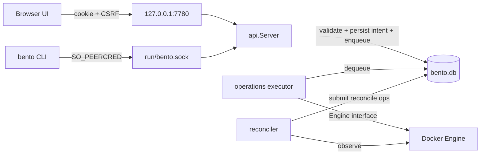

# Backend architecture

This document explains how the Go backend is put together and why.

## Processes and listeners

`bento serve --stack ROOT` is the only long-running Bento process for a stack. On start it:

1. refuses a root without `bento.db` (lost state fails closed; it never initializes) or one that is not a Bento stack;
2. takes `locks/controller.lock` (`flock`, held until exit) — offline `init`/`import` take the same lock, so one
   process owns a stack at a time;
3. opens the store (refuses foreign/old/future schema) and connects to Docker (a Docker outage is logged, not fatal);
4. marks operations left `running` by a previous process as `interrupted` (`Controller.Recover`);
5. starts the operation executor, the reconciler, the scheduler loop (`Controller.RunSchedules`), and the relay reaper;
6. serves the same HTTP handler on two listeners:
   - TCP on a **loopback-only** address (`cli.ValidateListen` rejects anything else) for the browser;
   - `run/bento.sock` (`0600`) for the CLI, wrapped by `Server.LocalOnly`, which admits only peers whose
     `SO_PEERCRED` uid is 0 or the backend's own uid.
   - **utils** TCP listeners (`--utils-listen`, default `127.0.0.1:7781` and `apps:7781`) serving
     `Server.UtilsHandler` only: self-authenticating routes under `/_bento/webhook/*`, and the ticketed database browser
     under `/_bento/dbadmin/*`, and nothing else (no UI, operator login, or management API). `apps:PORT` binds the host's address on the apps bridge (`NetworkSettings.AppsGateway`,
     read from the host's interfaces because Docker picks it, usually `.128`) once the bridge exists and follows the
     network plan, so the edge and cloudflared
     can reach it; the loopback address is for host proxies. Operators may bind any address because nothing on
     this listener works without a credential; `off` disables it.

On SIGTERM it stops both listeners, waits up to 60 s for the current operation, stops relays, and exits. Containers
are never stopped on shutdown.



## Package dependency direction

```text
cmd/bento → cli → api → operations → {runtime, dataservices, edge, backup, transfer, scheduler} → docker, store, domain, platform
                 → stack (init/import)
                 → reconcile → operations
```

`domain` has no I/O. `store` knows SQLite and `domain` only. `docker` is the only package importing the moby client;
everything else goes through the `docker.Engine` interface (tests use `docker.Fake`). `api/dto` imports nothing from
the rest of the backend, so the generated TypeScript never leaks persistence or SDK types.

## State: `store`

One SQLite file (`bento.db`, `0600`) opened with `modernc.org/sqlite` (pure Go), WAL, `foreign_keys`, a single
connection, and `BEGIN IMMEDIATE` transactions.

- **Versioning:** `PRAGMA application_id = 0x424E5431` marks a Bento Go database, `PRAGMA user_version` is the schema
  version (currently 1: the baseline every stack is created with, `store.MigratableFromVersion`). `store.CheckCompatible`
  probes with `mode=ro&immutable=1`, so refusing a foreign, older, newer, or non-SQLite file writes nothing (not even
  `-wal`/`-shm`). Earlier development schemas (2–5) were folded into this baseline on 2026-11-07 before any stack
  ran in production; a state file from them is refused as written by a newer Bento.
- **Migrations:** `store.Open` upgrades a file from `MigratableFromVersion` up to `SchemaVersion` after
  `quick_check`. It first writes a consistent copy (`VACUUM INTO`, `0600`) to
  `state-backups/bento.db.schema-<from>.<utc>` (`0700`, skipped by export), then runs `migrations[v]` for each step in
  one `BEGIN IMMEDIATE` transaction with `foreign_keys` off (so STRICT tables with `CHECK` enums can be rebuilt),
  checks `foreign_key_check` and `quick_check`, sets `user_version`, and commits. Any failure rolls back, leaves the
  file at its old version, and names the copy. A missing step or a downgrade is refused before anything is written.
  `stack.Import` accepts an export from any supported schema (`store.SupportedVersions`) and migrates it when it opens
  the copied `state.db`; other versions are refused before anything is created.
- **App home:** `apps.home_path` (NULL = `/home/<slug>`) is the in-container home (`domain.App.HomePath`, returned by
  `ContainerHome()`); the host path stays `homes/<slug>`. It is validated as `/home/<slug-shaped>`, written only at
  insert, and exposed read-only as the App DTO's `homePath`. `apps.access_log` toggles the app-local Nginx log.
  `apps.block_dotfiles|block_php_probes|block_sensitive_files` (all default 1; `domain.Protection`) select request
  classes both Nginx layers answer with 404 (never 403). `runtime.ProtectionConfig` renders the location blocks once
  and two templates include the text: `app-nginx.conf.tmpl` (PHP apps) and `edge-site.conf.tmpl` (only hosts that
  target an app; upstream and redirect hosts are operator-owned). The blocks sit before the static and
  front-controller locations and after operator `routes/` includes, so a drop-in `location` can override them. A
  change is a frontend-scope reload plus an edge apply; it never changes the container spec.
- **Tables:** `meta` (stack id/name, uid high-water mark), `settings` (JSON: uid range, edge, tunnel,
  network plan, operator password hash), `schedules`, `uid_ledger`, `apps`, `hosts` (Ingress: one row per host name,
  target `app` | `upstream` | `redirect`, per-host `route_json`; app hosts cascade with the app), `data_services`, `bindings` + `binding_databases` (add-only), `retired_apps`, `operations` +
  `operation_events` (≤200 events each), `sessions`, `api_tokens` (SHA-256 hashes, scope, expiry),
  `runtime_builds` + `app_runtime_builds` (managed runtime images and the build each app runs).
- **Rule:** repositories take a `store.Q` so they work inside or outside a transaction. Never hold a transaction
  across a Docker call.

### Identity allocation

`store.AllocateUID` runs inside the create transaction: next candidate = max(high-water mark, max ledger uid) + 1,
skipping host passwd/group collisions (`platform.FileHostIDs`), inserting a ledger row (`allocated`) and advancing the
high-water mark. Ledger rows are never deleted: provisioning success → `active`; removal → `retired` (or `burned` if
never provisioned). UID == GID. A rolled-back transaction frees nothing permanently because nothing was committed.

## Operations: `operations`

Every change with external effects follows the same path.

1. **Acceptance** (`accept.go`, called by API handlers): validate input, check preconditions and exact
   confirmations, then `Controller.Submit`, which in **one transaction** runs the `Mutate` callback (persist intent,
   e.g. `desired_runtime='stopped'`) and inserts the operation row. With an `Idempotency-Key`, an existing operation
   with that key is returned instead (a different kind/target with the same key is a conflict).
2. **Execution** (`controller.go`): one dispatcher goroutine scans the `queued` operations oldest first, marks each
   one it can start `running`, and runs the handler registered for its kind (`registerHandlers` in `apps.go`) in its
   own worker, up to `bento serve --op-concurrency` (default 4) at once. Handlers call `r.Phase(ctx, name)`
   between effects; that records the phase/event and is where a requested cancellation is honored cleanly. A
   cancellation still unhonored after `Deps.CancelGrace` (30 s) is **forced**: `watchCancel` cancels the operation's
   context, which ends the Docker call, pull, build or job wait in progress, and the operation ends `cancelled` with
   `ErrForceCancelled` and a `cancellation forced` event. Cleanup that must finish (resuming stopped apps, rolling
   back a clone, restoring the previous edge) already runs on `context.WithoutCancel` and is not interrupted.
3. **Completion:** the handler returns a result (stored as JSON) or an error. `*OpError` carries a stable code and
   operator guidance; other errors become `failed` with generic guidance. A panic is caught and recorded.

Parallelism is deliberately conservative. Each operation declares **claims** (`claims.go`): exclusive on its own app
or service, shared on the data services an app is bound to, or global. The dispatcher starts an operation only when its
claims do not conflict with any running operation or with any *earlier queued operation that has not started*, so
operations on the same resource keep FIFO order and nothing overtakes a waiting exclusive or global operation.

| Kind | Claims |
| --- | --- |
| `app.reconcile`, `app.start`, `app.restart`, `app.update`, `app.deploy` | exclusive `app:<id>`, shared `service:<name>` for each bound service |
| `app.stop` | exclusive `app:<id>` |
| `service.create`, `service.reconcile` | exclusive `service:<name>` |
| `image.prepare`, `image.rebuild` | exclusive `image:<key>`, in the `image-build` pool (at most `runtime.MaxConcurrentBuilds` = 2 at once) |
| `image.rollout`, `image.rollout-stop` | exclusive `image:<key>` (they only write build assignments) |
| `app.clone-from-backup`, `app.restore-from-backup` | shared `restic:<src>` / `restic-remote:<repo>`, in the `restic-clone` pool (one at a time) while downloading; then `Run.Escalate` turns them global before planning, creating and provisioning the clone |
| everything else, and any unclassified kind | **global**: runs alone, after everything before it, before anything after it |

`Run.Escalate` swaps the running operation's claims for global ones (so nothing new starts) and waits until every
other running operation has finished. Only kinds in a pool of size 1 may escalate, so two escalating operations never
wait on each other. After a restart, `Recover` submits `restic.recover` (global) when an interrupted clone or staging
leftovers exist: it rolls back the partial app (its id is in the clone's request), removes `staging/restic-*`,
`staging/home-sqlite-*` and `homes/.clone-*`, and removes backup job containers of finished operations. The reconciler
also collects *running* backup job containers whose operation has finished.

An `app.start` or `app.update` of an unprovisioned app is global because provisioning writes grants on shared data
services. The reasons for each global kind are the shared state it rewrites: the edge settings or several routes at once
(`edge.apply`, `app.publish|unpublish|remove`), data services and their grants (`app.provision`, `binding.add`,
`database.add`), removing from the image set (`image.prune`), home ownership (`app.permissions`), or every app at once
(`stack.export`), or a database in place (`restic.restore-db`).

A dispatch pass loads every app once (for the claims of app operations) and records, for each queued operation that is
blocked, the operation it waits behind. The API returns it as `waitingOn` on queued operations; the UI shows it on the
Activity page and in the operation tracker, and `bento ops` in the PHASE column. An operation that is only waiting for
a free slot has no `waitingOn`.

Parallel handlers share four things, each serialized inside the handlers:

- **Edge generations, container and reload** — `edgeMu` around `applyEdge`. It renders the whole route set, so two
  parallel applies would race on `edge/conf/{live,previous}`.
- **Network plan and creation** — `netMu` in `NetworkPlan`/`EnsureNetworks` (read-then-write of the plan setting and
  check-then-create of the Docker networks).
- **Runtime image builds** — `ImageManager.Hold(key)` serializes everything that decides whether a runtime key needs
  a build (callers re-read the current build under it, so one builds and the rest find it); different keys build
  concurrently, at most `MaxConcurrentBuilds` (2) at a time from any operation. `Remove` (image prune) excludes every
  `Hold`.
- **Route activation of a booting app** — while an operation is (re)starting an app's instance and has not seen it ready,
  the app is *warming* and every edge render treats it as not running, so another operation's `applyEdge` never routes
  to it early. If such an apply happened, the warming operation re-applies the edge as soon as the app is ready (a
  failure there is a warning; edge drift reconciliation retries). `EdgeConfigDrift` reports no drift while any app is
  warming, so the reconciler does not queue an `edge.apply` for a route that is about to be restored. The flag clears
  on readiness or when the operation ends.

Lock order when nested: image tag lock, `trafficMu`, `edgeMu`, `netMu`; `runMu` (running, warming and waiting state)
and `trafficStatusMu` are leaves.

Handlers re-read state from the store, so an operation that was superseded (e.g. `start` after a later `stop`) notices
and exits. `--op-concurrency 1` restores strictly serial execution; the maximum is 16. Shutdown stops dispatching and
waits for every running operation.

Engine calls have deadlines (`docker/deadline.go`): request/response calls 2 min (`Stop` adds its stop timeout), pulls
end after 5 min without progress or 1 h in all, builds after 20 min without output or 2 h. The error wraps
`docker.ErrEngineTimeout` and names the call. `Wait`, `Exec` and the streams (`Logs`, `Events`, `ExecAttach`,
`CopyFrom`) have no fixed deadline: they are ended by their context, which forced cancellation reaches.

Operation kinds: `app.provision|start|stop|restart|update|publish|unpublish|remove|prune|reconcile|permissions`,
`binding.add`, `database.add`, `service.create|reconcile`, `edge.apply`, `tunnel.apply`, `backup.rclone-test`,
`restic.*` (see *App backups*), `stack.export`.

### App lifecycle internals (`apps.go`)

- **provision:** `ensureHome` creates `homes/<slug>` (`0750`, app-owned), its `app/` code directory, and a root-owned
  `.bento-identity.json` sidecar, or verifies an existing home belongs to this incarnation (a foreign home is refused,
  never re-owned); creates SQLite dirs; provisions relational grants; materializes config; marks the
  app provisioned and the ledger row active. Idempotent.
- **ensureInstance:** verify durable state → ensure networks → `materialize` (resolve image, write config) → plan
  spec + fingerprint → observe. If an owned container exists with the same fingerprint, start it if needed; if the
  fingerprint differs, stop it, remove it, then create/start the replacement (never two instances at once). Duplicates
  or foreign containers on the name block the operation.
- **waitReady:** polls `checkReady` until `ReadyTimeout` (180 s): container running with the intended generation,
  `bento-ready` exec succeeds inside the container (scheduler socket when minicrond is on, `valkey-cli PING` when Valkey
  is on, FPM ping, local HTTP answers), and a direct HTTP
  GET from the backend to the container's apps-network IP gets an HTTP answer. With the default ready path any status
  counts: a new app that returns 500 until its setup is finished still starts and keeps its route, and the operation
  logs a warning with the status (`ReadyCheck.HTTPStatus`). Only an explicitly configured ready path must also return
  < 500 (`BENTO_READY_STRICT=1` in `runtime.env` applies the same rule to the Docker health check). An exited
  container fails fast with a log tail.
- **update:** if the boot fingerprint changed, replace; otherwise run `scopedReloads` for whichever of
  frontend/pool/scheduler files changed: validate with the running process (`nginx -t`, `php-fpm -t`,
  `minicrond validate`); on failure restore the previous bytes (`runtime.Changes.Restore`) and send nothing; on
  success reload (`nginx -s reload`, `s6-svc -r`, `minicrond reload`). The scheduler reload is skipped while
  minicrond is off; turning it on changes `runtime.env`, so the new instance reads the current `minicrond.toml`.
- **stop:** remove the edge route first, then set the restart policy to `no` and stop. If the edge apply fails the
  stop still proceeds with a warning; the stale route returns 502 until edge drift reconciliation reapplies it. The persisted intent plus
  `restart=no` is what keeps a stopped app stopped across backend and host restarts.
- **remove:** route removal (an edge apply failure is a warning, not a blocker, as for stop), container removal (owned only), verify nothing remains, record a `retired_apps` row
  listing retained artifacts, retire the UID, delete app rows, delete generated config.
- **prune:** drop the recorded relational databases and user, delete SQLite dirs and the home (only if its sidecar
  still names the retired app id). UIDs are never reclaimed.

## Reconciliation: `reconcile`

`Reconciler.Run` watches Docker events filtered to this stack's labels (hints only; a reconnect triggers a resync),
debounces triggers for 2 s, and also runs a full `Pass` every 60 s. A pass:

- skips any target with a queued/running operation;
- for initialized data services, submits `service.reconcile` if the container is not running;
- for provisioned apps: desired `stopped` but running → submit `app.reconcile`; desired `running` but missing, not
  running, or with a different planned fingerprint (`Controller.PlannedGeneration`, computed without writing files)
  → submit `app.reconcile`. Health alone never triggers action. A missing or stopped instance is repaired at once, in
  parallel with other apps; a **running** instance with a different fingerprint or config drift is replaced as part of
  a **rollout**, one app at a time (`Reconciler.rollout`), because a replacement stops the serving instance before the
  new one is ready. When a rollout replacement fails, the other apps on the same runtime image key keep their working
  instances (status `rollout paused: …`) until the failed app recovers — a later reconcile or operator operation on it
  succeeds — or is no longer desired running; apps on other image keys continue. When the key still has apps an
  operator `image.rollout` assigned but that are not yet confirmed on the new build, the pass instead submits
  `image.rollout-stop`, which puts them (the failed app included) back on their previous build: an operator rollout
  stops at its first failure. A finished rollout operation triggers the next pass;
- for a running app with no usable planned build (a changed image template or pinned artifact, such as a minicrond
  bump) → submit one `image.prepare` per runtime key instead, and leave the instance serving on its current
  image. The app is reconciled (replaced) only on a pass after the build has succeeded; the reconciler watches its
  pending prepares and triggers that pass as soon as one finishes. A failed build keeps the old instance and backs off
  under the `image:<key>` target. Apps that are missing or stopped build inline in `app.reconcile`, since nothing is
  serving;
- ensures the edge and tunnel exist when enabled, and match: the edge's rendered routes, its loaded generation and
  its fingerprint (image pin, ports, bind; `EdgeConfigDrift`), the tunnel's token generation and image pin
  (`TunnelDrift`);
- removes exited tool containers owned by the stack.

Each target has a retry budget: failures back off from 30 s doubling to 30 min; after 5 failures the target is
**blocked** until its config generation changes or an operator lifecycle action calls `ResetBudget`. Status is exposed
in app DTOs (`reconcile`, and `observed.state = blocked`).

Recovery of missing durable data is refused by the handlers themselves (`verifyHome`, `ensureService` with
`allowInit=false`), not by the reconciler, so the same rule applies to manual operations.

## Runtime planning: `runtime`

### Names and labels

`runtime.Names` derives every Docker name from the stack name: `bento-<stack>-app-<appId>`, `-tool-<appId>-<op>`,
`-edge`, `-cloudflared`, `-<service>`, `-job-<op>`, volumes `bento-<stack>-<service>-data`, networks
`bento-<stack>-apps` / `-data`, and the routing alias `app-<appId>`. Labels: `io.bento.managed`, `stack-id`,
`app-id`, `role` (`runtime|tool|edge|database|tunnel|backup|network|volume`), `generation`, `operation-id`,
`service`, `image-key`. `Names.OwnedBy` is checked before any stop/remove; names alone never authorize anything.

### Generated app configuration

`RenderAppConfig` produces, in memory:

| File (`apps/<appId>/config/`, mounted at `/etc/bento`, `0440 root:<gid>`) | Reload scope |
| --- | --- |
| `runtime.env` — non-secret metadata (`BENTO_APP_ID`, `BENTO_HTTP_PORT`, `BENTO_TRUSTED_PROXIES`, `BENTO_MINICROND`, `BENTO_VALKEY`, …); with Valkey on also `REDIS_HOST`/`REDIS_PORT`/`REDIS_URL`, each only if the app's env does not define it | boot |
| `credentials.env` — `DB_*`, `BENTO_DB_<n>_*` | boot (via credentials generation) |
| `app.argv` — NUL-separated argv (HTTP apps) | boot |
| `nginx.conf`, `fastcgi.conf` (PHP) | frontend reload |
| `php-fpm.conf`, `php.d/zz-app.ini` (PHP; the ini is on the image's `PHP_INI_SCAN_DIR`) | pool restart |
| `minicrond.toml` — config-owned `zz-bento-*` tasks (rendered even while minicrond is off; nothing runs them then) | scheduler reload |

plus `apps/<appId>/identity/{passwd,group}`: the image's own files (read once per image ID via a created-not-started
container and cached) with the app user appended. They are mounted as single files and are boot-static.

The whole directory is mounted (not individual files) so atomic renames inside it are visible to running processes.

### Container spec and fingerprint

`AppContainerSpec` sets: `User uid:gid`, read-only root, `CapDrop: ALL`, `no-new-privileges`, tmpfs `/run`
(uid-owned, **exec**, 64 MiB — s6-overlay needs to execute from it) and `/tmp`, Engine-API memory/CPU/PID limits,
`local` log driver (10 MB × 3), health check running `bento-ready`, restart `unless-stopped` (or `no`), working
directory `/home/<slug>/app`, and an endpoint on the apps network, plus the data network only when the app has a
MySQL or PostgreSQL binding (`needsDataNetwork`; tool containers follow the same rule, except that `OpenTool` for a
running app with Valkey on joins the app container's network namespace via `ShareAppNetwork`, so terminals, execs,
file edits and deploy hooks reach the app's loopback Valkey; a tool opened before a replace keeps loopback only). Mounts: own home, config dir, identity files, own
SQLite dirs. Nothing else.

`Fingerprint` hashes every boot-static, **non-secret** input (image ID, user, env, mounts, tmpfs, resources, networks,
hashes of `runtime.env`/argv/identity files, the credentials generation counter, and `specVersion`) into the
`io.bento.generation` label. Secret values never enter it; a credential change bumps `CredentialsGeneration` instead.
Bump `specVersion` whenever you change the shape of the spec so existing containers are replaced deliberately.

`ToolContainerSpec` uses the same image and mounts with entrypoint `bento-exec`, Docker's init, restart `no`, and an
idle `sleep` command; it never runs `/init`, starts no daemons, and does not take the instance lock.

### Managed images

`PlanImage` combines the embedded context for `php`, `php-sury` or `http` (`templates/images/common` overlaid with
the kind) with the Bento-owned build args: the floating base references (`domain.PHPVersions`, `DebianBase`,
`domain.ValkeyBuildBase`), the mise tool requests (`ImageKey.Tools`: `domain.PHPTools` or the
`domain.HTTPToolchains` entry), the Composer channel, the PHP floor (`domain.PHPMinVersions`) or Sury package floor,
and the pinned, checksum-verified artifacts in `domain.RuntimeArtifacts` (s6-overlay, minicrond, Valkey's source
tarball, mise). It hashes both into `ImageSpec.Hash`, the image's **inputs**.

Because the bases are floating tags and the tools follow release lines, building the same inputs twice can produce
different images. Every build therefore gets its own tag, `bento-runtime/<toolchain>:<version>-<hash12>-<time>`
(`ImageSpec.BuildTag`; an existing tag is never moved), always pulls its bases (`docker.BuildOptions.Pull`), and
records what it resolved: the image writes `/usr/local/share/bento-manifest` (`common/write-manifest.sh`: tool
versions and a digest of the installed Debian packages) and `ImageManager.Build` adds the local id of every base
reference under `base:<ref>`. Builds are rows of `runtime_builds` (key, inputs hash, tag, image id, manifest); one
per key and inputs is **current**. `app_runtime_builds` records the build each app runs:

- `Controller.plannedBuild` (read-only; used by `planContext`, so by the reconciler's drift check) is the app's
  assigned build when it is usable (same key and inputs, image still present under its tag), otherwise the key's
  current build, otherwise none (`DriftImageMissing`).
- `ensureAppBuild` (in `materialize`, tools and backups) builds the current build when none is usable — under
  `ImageManager.Hold(key)`, which serializes one key and excludes prune — and records the assignment.
- After a Bento upgrade that changes the inputs, every assignment is unusable, so apps move to the new current build
  through the normal rollout.
- `image.rebuild` builds with `NoCache` under `Hold`. A manifest equal to the current build's is discarded
  (`RemoveImage` of the new tag); otherwise it is recorded as current and apps keep their assignment.
- `image.rollout` (`RolloutRequest`: a build, default current; apps, default every provisioned app of the key planned
  on another build) assigns that build. Running apps are marked `rolling`; `waitReady` clears the mark once the
  instance is ready on that build's image (`confirmAppBuild`). The reconciler's drift check then replaces them, one at
  a time; `image.rollout-stop` reverts every still-rolling assignment of the key (`RevertRollingRuntimeBuilds`).
- Pruning an image deletes its build rows; assignments to them cascade away, and those apps fall back to the current
  build.

Builds use the Engine API classic builder (`build.BuilderV1`), so the Dockerfiles use no BuildKit features. Tar
headers use fixed modes and mtimes so the context is byte-reproducible. Toolchains are installed in a `toolchain`
stage, identical in every Dockerfile (`common/build-toolchain.sh`): mise installs `MISE_TOOLS` into `/opt/mise` at its
final path (Python compiled from source, so it links against that Debian release), every installed executable is
linked into `/usr/local/bin`, and the Debian packages they link against are recorded (as the PHP build does) so the
runtime stage installs exactly those. Operator-installed tools live in the app home: `env.bash` (and
`/etc/profile.d/bento-mise.sh` for login shells) puts `$HOME/.local/share/mise/shims` before `/usr/local/bin` and
trusts mise config under the home; `domain.ResticMiseExcludes` keeps that data out of backups. Valkey is compiled in
one build stage, identical in every Dockerfile, on `domain.ValkeyBuildBase` (`common/build-valkey.sh`:
checksum-verified source tarball, TLS and systemd off). It links only libc and libm, so that base must stay the oldest
Debian release among the runtime bases; each final stage runs `valkey-server --version` to prove the binary loads on
its base. Only `valkey-server` and `valkey-cli` reach `/usr/local/bin`. The classic builder shares a layer only when
every layer beneath it is identical: the `php` and `php-sury` final stages start with the same steps
(`php/install-tools.sh`, toolchain, s6, Valkey) before anything PHP-specific, so PHP versions on one Debian release
share those layers (until a refresh build, which bypasses the cache). `TestRuntimeImagesShareLayers` keeps the shared
steps identical and `TestPlanArgsMatchDockerfileARGs` keeps each plan's build args equal to its Dockerfile's `ARG`s.
The official-image PHP build refuses a base below `PHP_MIN_VERSION`, checks that OPcache and redis load, records
`php -m`, and the final stage fails if it loads a different module list (a missing library).

### Inside a runtime container

`bento-init` (entrypoint) refuses root, takes an exclusive `flock` on `$HOME/.local/state/bento/instance.lock`
(exit 75 if held) and `exec`s s6-overlay's `/init`, which inherits the lock fd. s6 services (`user-bundles.d`):

- PHP image: `nginx` (local frontend on :8080, internal FPM ping on 127.0.0.1:8081), `php-fpm` (single app pool),
  `minicrond`, `valkey`;
- HTTP image: `app` (argv from `/etc/bento/app.argv`, `PORT`/`HOST` exported), `minicrond`, `valkey`.

`minicrond` and `valkey` are per-app switches (`apps.minicrond`, default on; `apps.valkey`, default off) carried to the
container as `BENTO_MINICROND`/`BENTO_VALKEY` in `runtime.env`, so toggling one replaces the instance. A run script
whose switch is off marks itself run-once (`s6-svc -O .`) and exits 0, so s6 neither restarts it nor counts a failure.
`valkey` runs `valkey-server /etc/valkey/valkey.conf --dir $VALKEY_DATA` as the app UID: `bind 127.0.0.1 -::1`,
port 6379 (`domain.ValkeyPort`, refused as an HTTP app port), `protected-mode yes`, no password (only the app's own
container can reach it), `maxmemory` a quarter of the app's memory limit (`runtime.ValkeyMaxMemoryMB`, at least 16 MB, passed as
`BENTO_VALKEY_MAXMEMORY` to the run script) with `maxmemory-policy volatile-lru` (only keys with a TTL are evicted;
writes fail once only keys without one remain), RDB `save 3600 1 300 100 60 10000`
to `dump.rdb` in `~/.local/share/valkey` (`0700`), no AOF, logs on stdout. `VALKEY_DATA` is a reserved env key.

Every run script sources `env.bash`, which loads `runtime.env` and `credentials.env` key-by-key without shell
evaluation. `bento-finish` applies bounded backoff and halts the container after 5 failures of a service within
120 s, handing restart backoff to Docker.

## Networking and ingress

`Controller.EnsureNetworks` persists a network plan (two free `/24`s from `10.200.0.0/13`): the **apps** network
(egress allowed; dynamic addresses restricted to the upper `/25`; `.2` reserved for the edge, `.3` for cloudflared) and
the **data** network (`internal: true`). Apps and tools join apps, and data only when bound to MySQL or PostgreSQL; the edge and tunnel join apps only; data services
join data only. Those two reserved addresses are the only `set_real_ip_from` sources in app Nginx and the value of
`BENTO_TRUSTED_PROXIES`.

The edge (`edge` package + `operations/edge.go`):

1. `edge.Render` builds the full file set from current intent: one `sites/host-<name>.conf` per enabled host whose
   target is routable (an app host only while the app is `managed` + `published`), and one
   `upstreams/app-<slug>.conf` per app that a served host targets, shared by all of the app's hosts. TLS is per host,
   so each site has its own server blocks. Redirect hosts only `return 301`. App upstreams use `set $bento_upstream http://app-<id>:<port>; proxy_pass $bento_upstream;` with
   `resolver 127.0.0.11 valid=10s`, so a replaced container is re-resolved without a reload. Forwarding headers are
   overwritten, not appended.
2. If the output differs from `edge/conf/live`, it is staged in `edge/conf/candidate-*`, validated with `nginx -t`
   inside the running edge (or a throwaway validator container), and swapped with `live` using
   `renameat2(RENAME_EXCHANGE)`; the old generation is kept as `previous`.
3. The edge container is recreated only when its own settings fingerprint changes (ports, bind, HTTP/3, image);
   otherwise it gets `SIGHUP`. `edge/conf/loaded` records the digest (`edge.Digest`) of the generation the running edge
   last loaded — after a start, a recreate, or a delivered `SIGHUP`. Promotion swaps `live` before the reload, so a
   lost reload leaves `live` and `loaded` apart: `EdgeConfigDrift` reports that as drift and the next apply reloads
   although nothing new renders. A missing record (an edge from before it existed) costs one redundant reload. Includes in the generated config are relative, which is why candidates validate in place.
   The pinned image is ensured (pulled if missing) on every apply, before validation and any create, because an
   image-only bump renders identical routes. A recreate validates with the new image (a validator container; the live
   generation too when routes did not change), then renames the old edge to `bento-<stack>-edge-previous`, creates
   the new edge, stops the old one, starts the new one, and removes the old one. Any failure removes the new
   container and renames and restarts the old one, so ingress keeps its previous settings. The next apply settles a
   leftover `-edge-previous` from an interrupted recreate (restored if the edge is missing, removed otherwise; a
   foreign container with that name is refused).

**Front proxy** (`edge.frontProxy`, off by default): a TCP proxy in front of the edge, such as a public VPS forwarding
to a homelab over a VPN, connects to two extra listeners with `proxy_protocol` on fixed container ports
`edge.FrontHTTPPort`/`FrontHTTPSPort` (8080/8443), published on their own bind and host ports. `$server_port` marks
the path (`$bento_via_front`); a `geo` on `$realip_remote_addr` (the TCP peer, never a claimed address) checks it
against `trustedProxies`, and other peers on those ports get `444`. The visitor address is `$proxy_protocol_addr`
through a map (`$bento_client_addr`), not `real_ip_header`, which belongs to the tunnel. Like tunnel visitors, front
visitors used the standard ports: `$bento_std_ports` drops the port suffix and forwards 80/443, and `Alt-Svc` is not
sent because UDP is not forwarded. Accept refuses catch-all prefixes and prefixes overlapping the stack networks; the
render re-parses the list. With the feature off the rendered config is byte-identical to before, and the edge
fingerprint ignores it (only enabling, bind or ports recreate the container; the trusted list only reloads). The
access log line of an edge with a front proxy ends with `peer=$realip_remote_addr`, which names a
NAT that hides the proxy (Tailscale masquerades traffic Docker forwards unless `--snat-subnet-routes=false`).


Publication is persisted only after `checkReady` passes, and route activation is the last step of start/publish.

**ACME backoff** (`edge/acme.go`, `operations/edge.go`): the nginx ACME module keeps an unissued certificate's
retry state in memory and resets it to "request now" on every reload, and Bento reloads on most app operations, so a
host that cannot validate would burn the CA's failed-validation limit. `edge.PlanACME` keeps per-host state in the
`acme` setting: a served ACME host gets a 5-minute attempt window; if no valid certificate for it appears in the
module's state directory (`edge.IssuedCertificates` parses `*.crt` under `edge/acme`) the host is rendered with the
boot certificate and no `acme_certificate` (`Input.ACMEHold`) until `RetryAt` (1 h doubling to 24 h). A save of
the host (newer `UpdatedAt`) starts over; a valid certificate clears the state. The state is persisted only after
an edge apply succeeds, and a state change is edge drift, so the reconciler opens and closes windows. Each failure is
a warning on the `edge.apply`; `GET /hosts` reports `certificate` (`issued`/`requesting`/`waiting`). An apply also
warns when ACME hosts exist, `httpPort` is not 80, and neither a front proxy nor the tunnel can carry HTTP-01. The
module also drops in-flight challenge data on reload (nginx-acme #26): an apply that reloads, restarts or recreates
the edge marks every window opened before it (`MarkACMEReloaded`), and a marked window that closes without a
certificate ends in a 1-minute hold (`ACMEReloadRetry`, an Info line) instead of a failure, at most
`ACMEMaxReloadRetries` (2) times per host.

**Upstream hosts** load-balance their URLs in one `upstream` block; the first URL decides scheme, path and TLS name,
and validation requires the same scheme for all and, for HTTPS, the same host name. An HTTPS upstream named by DNS
is reached as that name: `proxy_ssl_server_name on`, `proxy_ssl_name <host>`, `proxy_ssl_verify on` against the edge
image's `/etc/ssl/certs/ca-certificates.crt` (depth 4), and `Host: <host>[:port]` so SNI-routed hosts (Cloudflare,
Vercel) answer; `X-Forwarded-Host` keeps the visitor's host. An HTTPS upstream named by an IP address is encrypted but
not verified (`proxy_ssl_verify off`, no SNI) and keeps the visitor's `Host`.

When the utils listener binds the apps network, every app and upstream host reserves
`location ^~ /_bento/webhook/`, proxied through the shared `bento_utils` upstream (`<apps-gateway>:<port>`,
`keepalive 2`) with an 8 MiB body limit; it never reaches the
upstream. Without an apps-network listener the path is left to the upstream. Other ingress (host nginx, a Cloudflare
Tunnel path rule, an operator proxy) forwards `/_bento/webhook/*` to a utils listener itself. `/_bento/dbadmin/*` is never reserved on app routes.

### Git deploy and webhooks

`app.deploy` runs in a tooling container as the app identity: a shallow (depth 1) clone or fetch of the branch (deploy key on stdin, `/tmp` only), then
`~/deploy.sh` when present in a **separate** exec (so the key is gone), then record the commit, then reload the app
process. `~/deploy.sh` must be a regular executable file owned by the app or root; anything else fails
`deploy-script-invalid` before any exec. It runs from `app/` with the app environment plus `BENTO_DEPLOY_TRIGGER`,
`BENTO_OPERATION_ID`, `BENTO_REPO_URL`, `BENTO_BRANCH`, `BENTO_COMMIT`, `BENTO_PREVIOUS_COMMIT` (last fully successful
deploy), and for webhooks `BENTO_WEBHOOK_{PROVIDER,EVENT,DELIVERY,REF,COMMIT,PUSHER}` (sanitized). A failing or
timed-out script leaves the new code checked out but does not record the deploy or reload the app.

A webhook (`settings` key `webhook:<appId>`) has a routing-only `hookId` and a 256-bit secret, returned only by the
enable/rotate response. `Controller.HandleWebhook` verifies `X-Hub-Signature-256` / `X-Gitea-Signature` /
`X-Forgejo-Signature` / Bitbucket `X-Hub-Signature` (HMAC-SHA256 over the raw body), `X-Gitlab-Token`, or
`Authorization: Bearer`; an unknown hook and a bad credential both return 404 and are not recorded. Only a push to the
configured branch deploys, and the payload never chooses what is fetched. A queued deploy absorbs further pushes
(`coalesced`); a provider delivery id is the idempotency key (`duplicate`). The last 20 authenticated deliveries are
kept with their result, the verifying credential, and the pusher. The `utils` setting's `baseUrl` (pure display
intent, `PUT /api/v1/utils`) builds full webhook URLs and database browser links; without it the app's display host (its first enabled
host) is used when the edge forwards webhooks. Removing the git source or the app destroys the webhook.

## Host traffic reports: `operations/traffic.go`, `traffic`

A host with `route.accessLog` gets, besides its unfiltered `access_log /dev/stdout bento_edge`, a second
`access_log /var/log/bento-edge/<host>.log bento_traffic if=$bento_traffic` (`edge.TrafficLogFile`; `edge.LogsMount`
is `traffic/logs/` of the stack root, mounted read-write; edge shape version 2). The `bento_traffic` maps and
`log_format` are rendered only when some served host has its access log on, so other stacks render byte-identical
config. They skip static extensions, dotfiles (not `/.well-known/`), `404` and `444`, and log `$request_uri` and the
referrer without `?…`.

`Controller.RunTraffic` (started by `serve` beside the scheduler) runs `TrafficCycle` two minutes after every
`traffic.Interval` (1 h, wall clock). It is housekeeping, not an operation: nothing in it changes desired or runtime
state, a failure is logged and kept in memory (`TrafficStatus`, shown on the report), and the next run retries. A
cycle, under `trafficMu`:

1. under `edgeMu` (so no recreate interleaves), renames each non-empty regular `traffic/logs/<host>.log` (normalized
   host names only; symlinks and other names are ignored) to `traffic/hosts/<host>/pending/<UTC>.log`, then sends the
   running, owned edge `USR1` whenever anything was renamed or any pending file exists. Without a running edge
   nothing writes and no signal is needed. If the signal is not delivered, no pending file is read this cycle: the
   edge may still be writing to it;
2. waits 2 s for workers to reopen, then for each host directory: a host that no longer exists loses its directory;
   otherwise up to 48 pending files go to one GoAccess job (`domain.GoAccessImage`, pinned by digest and pulled on
   first use; network `none`, read-only root, `CapDrop ALL`, `no-new-privileges`, 512 MiB, 1 CPU, 64 pids, 10 min,
   only the host's directory mounted at `/traffic`). `traffic.Args` runs `--restore --persist --keep-last=30
   --no-query-string --max-items=50`, ignores unshown panels, and writes `report.next.json`; on exit 0 it is renamed
   to `report.json` and the files read are deleted. GoAccess remembers each file's inode and last line, so re-reading
   a file after a crash between the run and the delete adds nothing (verified). With no pending file, a report older
   than 24 h is rewritten from the database so `--keep-last` drops old days. Pending files older than 7 days are
   dropped with a warning.

`GET /api/v1/hosts/{name}/traffic` (read scope) only reads `report.json` and parses it with `traffic.Parse` into
`dto.HostTraffic` (`off` / `waiting` / `ready`, plus the last run's error and pending bytes); an unreadable report is
`503`. `traffic/` is skipped by export (`RootSkip`).

## Data services and backups

`dataservices.Manager` creates each service's secrets once (`services/<name>/secrets`, `0400`; MySQL gets a
`client.cnf`), runs containers on the data network with their named volume, and treats a service as ready only when it
answers over **TCP** (first-boot entrypoints run a socket-only temporary server). Administrative SQL is sent on exec
stdin; identifiers are validated against `^[a-z][a-z0-9_]{0,62}$`. Provisioning refuses an existing database that the
binding's user does not already own. MySQL grants name exactly one database (`dataservices.MySQLGrant`): in a
database-level grant `_` is a wildcard, so `a_b_main` would also cover another app's `a1b_main`; the grant is on
`` `a\_b\_main`.* `` and provisioning revokes an unescaped grant left by an earlier version. The engines are MySQL and PostgreSQL; there is no shared cache service (an app's
Valkey lives in its own container, see *Inside a runtime container*).

`ensureService(allowInit)` creates a volume only for a never-initialized service; for an initialized service a missing
volume is a `volume-missing` failure. Volumes are never removed (except volumes a failing `import` created itself).

Backups are app backups only (restic, below); the `backup` package dumps and restores binding databases for them.
`DumpPlain` streams `mysqldump`/`pg_dump` exec output into a `0600` file; SQLite uses `.backup` in a network-less job
container that mounts only that binding directory and a private staging dir. rclone runs in job containers of the
pinned image with the `rclone/` directory (writable, so OAuth token refreshes persist). Before any rclone container
runs, `backup.checkRemote` requires `rclone.conf` to be a regular, unencrypted file that defines the remote; the API
only ever reads section names and `type`. The rclone shell (`GET /backups/rclone/terminal`) is the same terminal
machinery as app shells (`serveTerminal`, keyed by scope) over an idle `sleep` container of that image that mounts only
`rclone/`; `backup.rclone-test` runs `rclone lsf --max-depth 1` and treats exit 3 (directory not found) as reachable.
Database dump artifacts of older versions may remain in `<root>/backups/`; nothing reads them, export skips them.

MySQL dumps pass through `definerFilter`, which removes `DEFINER=` from DDL lines and never touches `INSERT` lines,
however the exec output is chunked. Relational restores (`backup.RestoreRelational`, used by `restic.restore-db` and
by clones) never replay a dump as the administrator:

- The dump is replayed into a staging database, `bento__rs_<sha256(db)[:16]>` (`domain.ReservedDatabasePrefix`
  is refused for app databases), as the binding user. MySQL logs in through a per-restore option file
  (`dataservices.AppClientFile`, `0400`, removed afterwards), after the restore stream passes the same
  `definerFilter`. PostgreSQL runs `psql -U <user>` over the local socket, not superuser plus `SET ROLE`. Every
  restored view, routine, trigger and event therefore belongs to the binding user, and a dump statement beyond the
  user's grants (`GRANT … ON *.*`, `RESET ROLE`, another database) fails. MySQL's binary log is on, so a dump with
  triggers or stored functions fails too, exactly as the app could not have created them itself.
- A failed replay (a read error is recorded by `checkedReader`, because the client may exit 0 on the early end of
  input; restic has already verified the dump's content), a refused statement, or a cancellation before the `swap`
  phase drops the staging database and leaves the live one untouched (`backup.LiveUnchangedError`, guidance "The live database is unchanged").
- Swap: PostgreSQL refuses new connections to the live database, terminates its sessions and renames live → trash
  and staging → live in one transaction (a failed swap re-allows connections). MySQL moves every live table to
  `bento__rt_…` and every staged table into the live database in one `RENAME TABLE` (atomic; `lock_wait_timeout`
  60s). The live database's triggers and views are dropped just before it, and its routines and events just after.
  The app keeps running. Trash and staging databases are dropped afterwards; a leftover is dropped by the next
  restore of that database only if it is owned by (PostgreSQL) or granted to (MySQL, `_`-escaped grant) the binding
  user, and refused otherwise.
- MySQL cannot move views, routines or events between schemas. When the staged database has any, the handler stops
  the app (`RestoreOptions.Quiesce`), the live database is dropped and the artifact replayed into it a second time
  (the staging replay proved that it replays), and the app is started again (`resumeStopped`). The result's `method`
  is `swap` or `in-place`.

## Scheduler: `operations/schedules.go`

Platform jobs are rows in `schedules` (`id`, `kind`, `cron`, `enabled`, `spec_json`, bookkeeping). App jobs are not:
they run in each app's own minicrond as the app UID (nothing runs, Bento's `zz-bento-*` tasks included, while the
app's minicrond is off). `Controller.RunSchedules` ticks every 30 seconds, evaluates enabled rows in the server's local
time zone (`last_slot` is stored in UTC and converted back before `cron.Next`), and for a due slot calls the kind's
`Submit`, which only queues a durable operation. Rules:

- Slots missed by more than 10 minutes are counted as missed and skipped, unless the kind sets `CatchUp` (run once).
- A slot is skipped (`last_state=skipped`) while the schedule's previous operation (`last_op_id`) is not terminal.
- Bookkeeping is saved only if `revision` is unchanged, so a concurrent edit (which resets `last_slot` to now) wins.
- Unknown kinds are left untouched. Import disables every schedule and clears its bookkeeping.

To add a kind: register it in `scheduleKinds`, validate its spec where it is edited, and submit an existing or new
operation kind (with its claims) from `Submit`.

## App backups (restic): `operations/restic.go`, `backup/restic.go`

App backup is the only backup method: each snapshot holds the home and a plain dump of every bound database. The web
Backup tab (`BackupPanel.tsx`) shows the restic settings, repository, snapshots (Clone into a new app, Restore DB in
place) and keys; the Backups page shows the stack-wide overview (`GET /backups/apps`), runs and rclone remotes.

Each app may have one restic repository on an rclone remote: operator settings under `settings` key `restic:<appId>`,
operation bookkeeping (repository id, cached snapshots/keys, last runs) under `restic-state:<appId>`, schedule row
`restic-<appId>` of kind `app-backup`. The key Bento uses lives in `secrets/restic/<appId>.key` (`0400`).

The stack backup password, `secrets/restic/stack.key` (root, `0400`), is the key of every repository the stack
initializes. `bento init` creates it, and `backup.EnsureStackKey` creates it on the first `restic.init` of an older
stack (published with `link(2)`, so concurrent callers agree on one). The API never returns it; `bento backup password`
reads the file on the host. It travels with export. Init writes the stack password, key-add a new random key, to a
`*.pending-*.key` file named (not contained) in the request; only key-add returns its key, once, in the `202`. The
operation consumes and deletes the pending file. Connect (and restore-from-backup) verifies an operator key with
`restic cat config` before adopting it; an empty key means the stack password, and a stack without one refuses it
rather than creating one. Every job checks the repository id against the recorded one.

restic runs by exec in an idle job container of `bento-backup/restic:<version>-<hash>` (built by
`ImageManager.EnsureRestic` from `templates/images-standalone/restic`: the pinned rclone image plus a SHA-256-pinned
restic). The container mounts a read-only ctl dir (key copy, generated exclude file), the restic cache, `rclone/`, and
either the home and staging data read-only at `/backup/home` and `/backup/bento` (backup: `CapAdd DAC_READ_SEARCH`
only) or an empty staging restore target (restore: `CHOWN`, `FOWNER`, `DAC_OVERRIDE`). It never mounts the live home
writable.

`restic.backup` (shares `app:<id>` and bound services, `restic:<id>` exclusive, pool of 2): plain dumps first
(`DumpPlain`), then `.backup` copies of minicrond's and listed home SQLite files (`SnapshotHomeSQLite`, as the app
UID, network `none`), `app.json` (env values with secret-looking names redacted) and `manifest.json`, then one
`restic backup` with the sidecar, live SQLite files, minicrond's log database/socket, and Valkey's in-progress
`temp-*.rdb` excluded (`dump.rdb` is replaced only by rename, so it is always a complete snapshot and is backed up
with the home) (tags `app=`,
`stack=`, `slug=`, `trigger=`), then `forget` filtered on `app=<id>,stack=<id>` (and `--prune` at most weekly). Only
minicrond's `minicron.db` is snapshotted. `manifest.json` is format 2 (`homePath` from `ContainerHome()`, per-dump
binding/suffix/username, SQLite `fileId`/`fileName`, `minicron`, `secrets`); `readManifest` still reads format 1.
`app.json` carries `valkey` and `minicrond`; a snapshot without `minicrond` restores with it on, and a clone with
Valkey on starts from the backed-up `dump.rdb` (the clone checklist says so). When the app's `includeSecrets` setting
is on, `secrets.json` (`0600` in staging) holds the redacted env values and
binding passwords; `app.json` stays redacted, and `secretRedactor` scrubs those values from operation output. Restic
exit 3 records the run as `partial` (not OK). Files are never restored over a live app (clone into a new app instead);
a single database is, by `restic.restore-db`.

`restic.restore-db` (`restic_restore_db.go`; global: it stages and grants on shared data services) needs the exact
confirmation `replace <db>` and a database of one of the app's bindings. It resolves the snapshot in the app's own
repository, reads `manifest.json`, refuses a snapshot of another app (`snapshot-invalid`) or one with no dump of that
database and engine (`database-missing`), and restores only that dump (`restic restore --include
/backup/bento/<file>`; the manifest path must match `^(db|sqlite)/[A-Za-z0-9_.-]+$`, so no glob reaches restic). The
restored `bento/` tree must hold only directories and regular files. A relational dump goes through
`backup.RestoreRelational` (the app keeps running through a swap; an in-place MySQL rebuild stops and restarts it); a
SQLite file needs the app stopped (`app-running`) and replaces the binding file with `RestoreSQLite`.

## Transfer

`stack.export` stops running apps and services, takes `VACUUM INTO state.db`, archives the root (excluding the live DB,
`run`, `locks`, `cache`, `staging`, `backups`; sockets skipped) as zstd tar with numeric ownership, archives each
volume with a `tar` job container, writes `manifest.json`, makes everything `0600`, and restarts exactly what it
stopped. `stack.Import` validates the manifest (format, version, schema, safe file names, architecture), extracts with
`transfer.ExtractRoot` (relative clean names only, symlinks relative and contained, no writes through symlinks, no
device nodes, `O_EXCL`), assigns a new stack id, forces apps stopped/unpublished, cancels queued/running operations,
disables edge/tunnel/schedule, drops the network plan, re-stamps home sidecars, restores volumes, and on failure removes
only what it created.

## API surface: `api`

- `http.go`: strict decoding (`application/json`, 1 MiB, `DisallowUnknownFields`, no trailing data), error mapping to
  stable `dto.ErrorCode`s, `Idempotency-Key` format, path id validation.
- `auth.go`: argon2id password (`settings.auth`; new hashes use OWASP's minimum, 19 MiB / 2 iterations / 1 lane,
  and a hash with other parameters is re-hashed at the next successful login without revoking sessions), 12-hour sessions stored as SHA-256 token hashes, `HttpOnly`
  `SameSite=Strict` cookie, login rate limit (10 failures / 5 min, counting checks in flight, so a burst cannot all
  pass before one fails) with at most 2 password checks at once — others get `429` unhashed —
  and for writes: exact `Origin` in
  `AllowedOrigins`, `Sec-Fetch-Site: same-origin` when present, and `X-CSRF-Token` equal to the session's token.
  Changing the password revokes every session (not API tokens).
- `scopes.go` + `tokens.go`: API tokens and scopes. `routeScopes` maps each route pattern to the least scope
  (`read` < `operate` < `admin` < full); an unlisted route needs full (session or unscoped socket), so new routes
  are closed to tokens by default. `requireAuth(scope)` checks a principal already in the context (control socket,
  or an MCP tool call re-entering the mux), else `Authorization: Bearer bento_pat_…` (no CSRF: browsers never send
  it unprompted), else the session. The socket accepts `X-Bento-Scope` to narrow itself (`bento mcp`). Restricted
  callers see env values as `[redacted]`, cannot change env, and cannot restore databases; their operations get origin
  `token:<name>` / `local:<scope>` via `operations.WithOrigin`. Token management is full-scope only; import deletes
  every token.
- `POST /mcp`: stateless Streamable HTTP for tokens and scoped sockets (sessions refused, foreign `Origin` refused).
  Tools live in `internal/mcp` and call the API through `inProcess`, a `RoundTripper` that serves the mux with the
  caller's context, so every tool call is scope-checked like a direct request. `bento mcp` serves the same tools on
  stdio over the control socket.
- `schedulerapi.go`: the token-facing app scheduler routes (`/apps/{id}/scheduler/{jobs,workers,runs}…`). Each sends
  one fixed request to minicrond's HTTP API (under `runtime.SchedulerBasePath`) over the scheduler relay, like the
  gateway, and needs the app's minicrond on and the app desired-running (else `409 precondition_failed`). Output is allowlisted into `dto.Scheduler*` (job env keys only, app
  secrets redacted from commands and log lines); names and run ids are validated before anything is sent. Admin may
  create (`POST`, sent with `If-None-Match: *`) and edit (`PATCH`: read the full definition, apply only the given
  fields to its raw JSON so unmodelled fields and env values survive, `PUT` with `If-Match` on the revision read).
  A job is an arbitrary command as the app, so admin is exec-level here. `zz-bento-*` is reserved. Import and delete
  stay on full-scope `scheduler/command`. These routes act directly, like exec, and are not operations.
- `appfiles.go`: admin list/read/write/replace of files under `~/app` only. `domain.CleanRelative` refuses absolute,
  `..` and hidden paths; each access is a fixed bash script exec'd as the app UID through `bento-exec` (running
  instance, else a tool container), path as an argument, which re-checks the `realpath` stays inside `~/app` and out
  of hidden paths. The backend never opens app paths as root. Writes refuse symlink targets, go to a temp file in
  the same directory and are renamed over the target (mode kept), and replace only when the on-disk sha256 matches.
  Reads are UTF-8 only and redacted; `[redacted]` is refused in written text, and `PATCH` replaces text on the real
  bytes so secrets elsewhere in the file survive. Not operations, like exec.
- `server.go`: routes and resource handlers; mutations respond `202` with the operation and `Location`.
- `stream.go`: logs as SSE (tail ≤ 5000, 30 min, 20 MB, the app's secrets redacted, resume via `since`/`Last-Event-ID`),
  operation events as SSE, bounded exec (1 MiB, 10 min), `minicrond` passthrough (refuses `daemon`), and the
  WebSocket terminal (origin + CSRF query token for browsers; binary frames for bytes, JSON text frames for
  `resize`/`exit`; 30 min idle, 4 h max). Log lines over 256 KiB are truncated with a `…[truncated]` marker and the
  stream continues. Exec and `minicrond` output get the same secret redaction as logs. The interactive terminal PTY
  stream is deliberately **not** redacted: a secret can be split across arbitrary chunk boundaries and terminal escape
  sequences, and the operator can already read the app's secrets from its environment inside that shell, so
  redaction there would give false assurance.
- `gateway.go`: the scheduler UI gateway (see below). The management handler serves no app-controlled page or script.
- SPA serving: existing files are served; client routes fall back to `index.html`; asset-like paths 404.

## Database browser: `api/dbadmin.go`, `operations/dbadmin.go`

`dbadmin.apply` (setting `dbadmin`, `PUT /api/v1/dbadmin`) runs one pinned `adminer` container
(`bento-<stack>-dbadmin`, role `dbadmin`) on the data network only: user `100:101`, read-only root, no capabilities,
`/tmp` tmpfs, and one read-only mount of `<root>/dbadmin` (`0750 root:101`) holding `router.php` (embedded from
`templates/dbadmin`) and a generated `gateway-token` (`0440`). The generation label hashes the router, image, and a
version; the reconciler recreates a missing, stopped, or outdated container while enabled.

`POST /api/v1/apps/{id}/bindings/{bid}/dbadmin` (browser session only) issues a one-minute single-use ticket held in
memory by token hash. `GET /_bento/dbadmin/t/<ticket>` on the utils listener redeems it for a grant cookie
(`bento_dbadmin`, HttpOnly, SameSite=Lax, path `/_bento/dbadmin/b/<bid>/`, 30 minutes idle) and redirects. Each
`/_bento/dbadmin/b/<bid>/…` request checks the grant, `GetLiveSession` for the issuing session, same-origin fetch metadata
on writes, the setting, and the binding; then it proxies to the container's data-network address (the host reaches
the bridge), forwarding only `adminer_*` cookies and adding `X-Bento-*` headers (driver, service host, user,
base64 password, databases, gateway token). `router.php` checks the token, forces those values into Adminer on every
request, and keeps only a placeholder password in Adminer's session. Response cookies are re-scoped to the binding
path. Tickets and grants do not survive a backend restart.

## Scheduler UI gateway: `api/gateway.go`

minicrond's UI is served on the management origin at `runtime.SchedulerBasePath` = `/apps/<slug>/scheduler`
(`BENTO_SCHEDULER_BASE_PATH`); the bare path without a trailing slash stays a client route of the web UI, and
`/apps/{slug}/scheduler/` is the gateway. Every request needs a live operator session cookie (a missing session is a
plain-text 401), the slug must be an app's slug (not its id) with minicrond on (else a plain-text 503) that is desired
running, and writes need an exact allowed `Origin` plus same-origin fetch metadata. The CSRF token is deliberately not
required: minicrond's UI is never given it.

**Trust boundary.** The app's UID owns its minicrond socket directory, so a compromised app can stop minicrond and put
its own server behind the relay. Nothing that server sends may run on the management origin, so the gateway splits by
path:

- **Page and assets come from Bento.** `internal/schedulerui` embeds minicrond's built UI (`index.html`, one script,
  one stylesheet), vendored from the release tag of the pinned `MINICROND_VERSION` by `make vendor-minicrond-ui`
  (`VERSION` records the tag and commit; `TestVendoredVersionMatchesPin` fails if the pin moves without it). The
  gateway renders the shell for every client route the way minicrond's own handler does (`<base href>` set to the
  base path, entry links under `assets/`) and serves `assets/<name>` with an ETag. These responses replace the
  management CSP with minicrond's own policy, relaxed only to `frame-ancestors 'self'` and `X-Frame-Options:
  SAMEORIGIN`, so the Scheduler tab can frame them. Non-GET requests get 405. None of them dial the relay.
- **Only `/api/…` crosses the relay, and only data comes back.** `hardenSchedulerResponse` refuses (502) redirects
  and any media type other than `application/json`, `text/plain`, `text/event-stream`, or `application/toml`
  (minicrond's export), as well as a body with no type. What passes loses `Set-Cookie`, `Location`, `Refresh`,
  `Link`, and the app's CSP/framing/referrer headers, and gets `Content-Security-Policy: sandbox; default-src
  'none'` next to the management policy, `X-Frame-Options: DENY`, `nosniff`, `Cache-Control: no-store`, and
  `Cross-Origin-Resource-Policy: same-origin`. A relayed answer opened as a document therefore has an opaque origin
  and runs nothing.

Cookie, authorization, CSRF, and forwarding headers are stripped before a request crosses the relay. Streaming uses
`FlushInterval: -1`; bodies are capped at 10 MB. A compromised app can still return false data to its own Scheduler
tab and act on its own minicrond; it cannot run script beside the Bento UI. As a second layer, creating an API token or
changing the password from a browser session requires the current password (`confirmCurrentPassword`; root on the
control socket is exempt for recovery).

## Scheduler relay: `scheduler`

minicrond authorizes Unix-socket callers by peer UID. For each app, `RelayManager.start` (root):

1. validates `homes/<slug>/.local/share/minicron/minicron.sock` (no symlinks below the home, a socket, owned by the
   app UID);
2. listens on `run/relay/<appId>.sock` (`0600`, root-only directory);
3. opens the socket's directory with `O_DIRECTORY|O_NOFOLLOW`;
4. starts `/proc/self/exe internal-relay` with `Credential{Uid, Gid, Groups: []}`, `Pdeathsig`, and the listener
   (fd 3) and directory (fd 4) as inherited descriptors.

The child refuses to run as root, `fchdir`s to fd 4 (so it needs no traversal rights above the app-owned directory and
avoids `sun_path` limits), re-checks the socket's owner on every connection, and splices bytes. The backend never
changes its own UID and never execs into containers per request. Relays idle for 10 minutes are stopped.

## Security invariants (checklist for reviewers)

- No secret in argv, labels, the fingerprint, logs, API responses, or container env; secrets travel via exec stdin,
  or `0400/0440` files.
- App containers: numeric app UID/GID, read-only, no capabilities, `no-new-privileges`, no host ports, no Docker
  socket, only their own home/SQLite/config mounted.
- Destructive actions check labels, role, and (for app containers) the home mount first.
- Exact confirmations are enforced server-side in `accept.go`, not only in the CLI/UI.
- Missing durable data blocks; nothing is ever silently re-created empty.
- The management API is loopback-only and requires a session, a peer-verified local socket, or a scoped API token.
  No token scope reaches deletes, restores, exec, terminals, or credentials.
- The utils listener serves only routes that authenticate themselves: deploy webhooks (per-app secret; can at most
  queue a deploy of the configured branch) and the database browser (single-use ticket from a session + CSRF call,
  then a binding-scoped grant re-checked against the live session on every request). The scheduler UI is not served
  there. Never add Bento's own UI, login, or management routes to it.
- No app-controlled page or script is served on the management origin. The scheduler page and its assets are the
  vendored minicrond bundle (`internal/schedulerui`); only `/api/…` data crosses the app's relay, restricted to data
  media types and sandboxed. The management UI sets `frame-src 'self'` and `frame-ancestors 'none'` (only the
  vendored scheduler page relaxes the latter to `'self'`, so the Scheduler tab can embed it), and `Origin: null`
  never passes the origin check.
- Creating an API token or changing the password from a browser session requires the current password.
- The Adminer container holds no credentials, joins only the data network, and refuses requests without the
  gateway token. The gateway injects one binding's app-user credentials per request; URL parameters cannot select
  another server, driver, user, or database.
